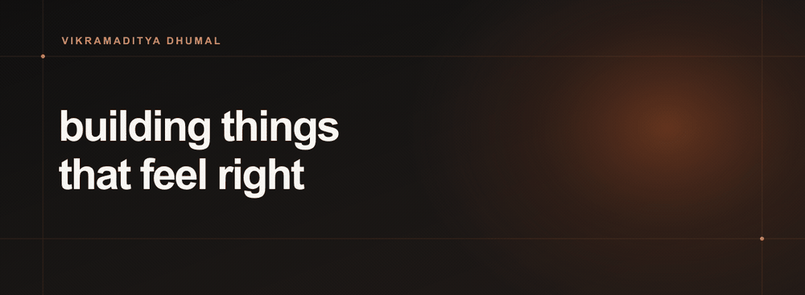

<picture>
  
</picture>

 

## curious by nature. a builder at heart.

i'm vikramaditya, an independent developer who enjoys turning ideas into thoughtful, useful digital products. i've been freelancing since 2020, working across design and development while exploring web, mobile, ai, and interactive experiences.

**[portfolio ↗](https://www.vikramadityadhumal.com/)** &nbsp;&nbsp; / &nbsp;&nbsp; **[say hello ↗](mailto:dhumalvikramaditya287@gmail.com)** &nbsp;&nbsp; / &nbsp;&nbsp; **[linkedin ↗](https://www.linkedin.com/in/vikramaditya-dhumal-322a60358/)**

## what i enjoy building

i enjoy taking an idea from an early concept to something people can use. that might mean shaping an interface, building the application behind it, or exploring how ai and interactive technology can make an experience more useful.

my work spans independent projects, freelance collaborations, and experiments that help me learn by making. i care about the details that make a product feel considered and approachable.

## tools & technologies

these are some of the tools i’ve worked with across apps, experiments, and collaborations. i’m comfortable learning new technologies as a project calls for them, and i enjoy choosing tools that fit the problem.

| area               | technologies                                       |
| :----------------- | :------------------------------------------------- |
| **languages**      | `typescript` `javascript` `python` `java` `kotlin` |
| **frontend**       | `react` `next.js` `tailwind css` `three.js`        |
| **mobile**         | `react native` `expo`                              |
| **backend & data** | `node.js` `firebase` `postgresql` `mongodb`        |
| **cloud & ai**     | `google cloud` `gemini` `genkit`                   |
| **tools**          | `git` `github` `docker`                            |
